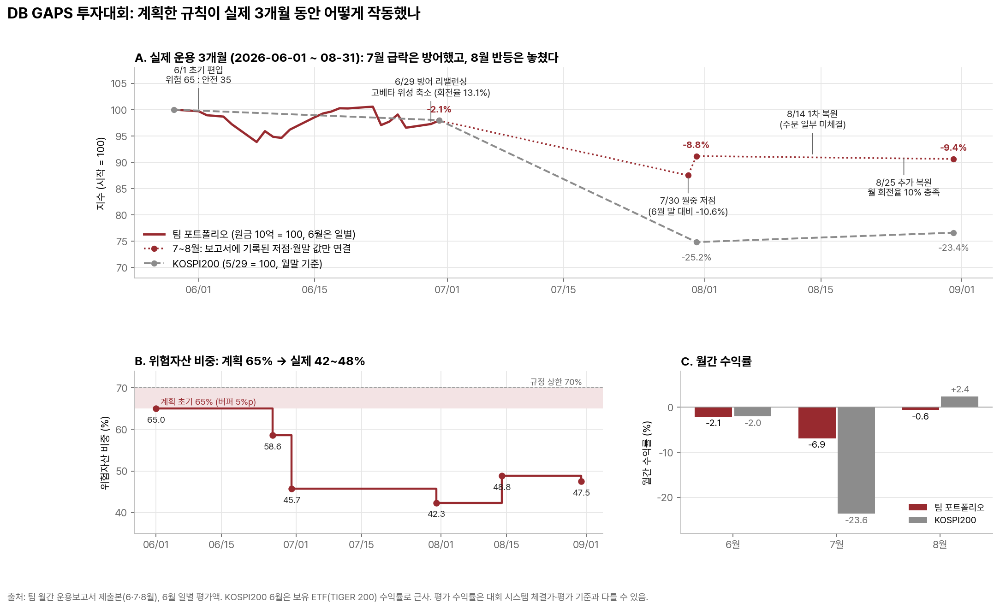
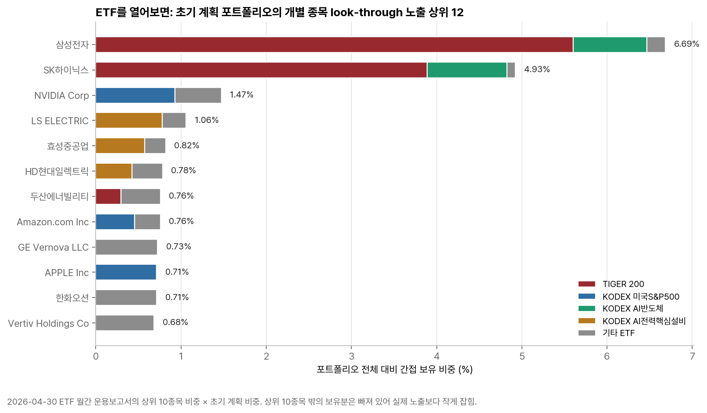
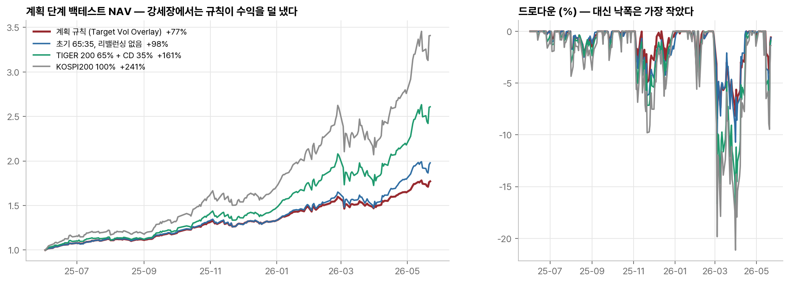
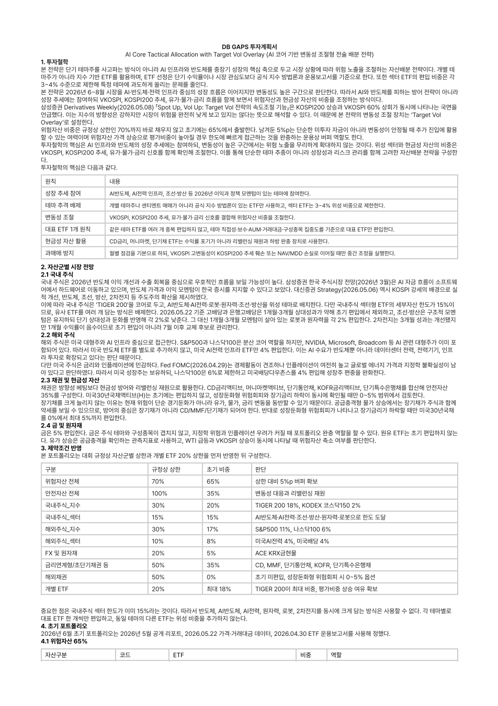
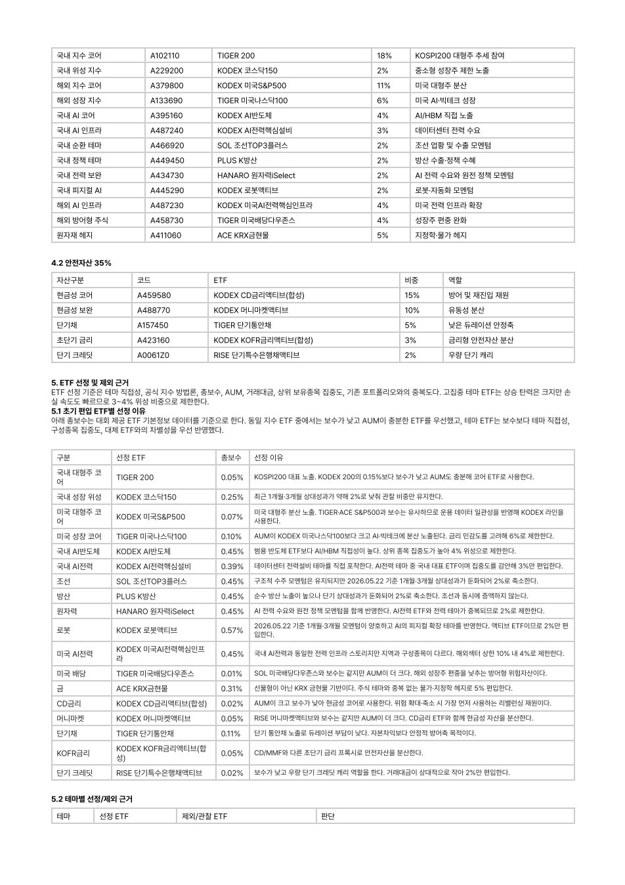
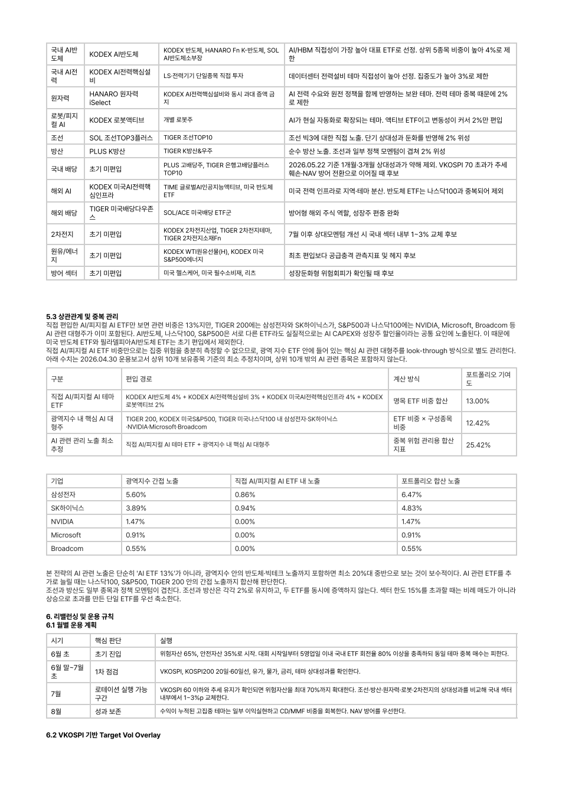

# DB GAPS 투자대회 — ETF 자산배분 계획과 3개월 실제 운용 기록 (2026.06 ~ 08 · QUANTIFI 팀 Quantifi_1)

> AI·반도체 성장 추세와 높은 변동성이 공존한다는 판단 아래 "위험자산 65%로 시작하고, 변동성·추세·손실 신호가 겹치면 줄인다"는 규칙을 세웠습니다. 실제 3개월 동안 이 규칙은 **7월 KOSPI200 -23.6% 급락에서 손실을 -6.9%로 막았지만, 8월 반등은 따라가지 못해** 누적 -9.4%로 끝났습니다. 이 저장소는 계획·주문·결과를 구분해 그 과정을 기록합니다.

[투자계획서 PDF 보기](docs/DB_GAPS_투자계획서.pdf) · [계획 단계 백테스트 코드](src/gaps_backtest.py) · [투자계획 노트북](notebooks/gaps_investment_plan.ipynb)

## 대표 차트

[](output/charts/hero_plan_vs_realized.png)

## 한눈에 보기

| 항목 | 내용 |
| --- | --- |
| 대회 | DB GAPS 투자대회, 운용기간 2026-06-01 ~ 08-31, 원금 10억 원, 국내 상장 ETF만 사용 |
| 규정 | 위험자산 ≤ 70%, 개별 ETF ≤ 20%, 국내주식 섹터 ≤ 15%, 금리연계형/초단기채 ≤ 50%, 월 회전율 ≥ 10%, 거래수수료 0.1% |
| 전략 | AI Core Tactical Allocation with Target Vol Overlay — AI반도체·AI전력 코어 + 조선·방산·원자력·로봇 위성(각 2~4%) + CD·MMF·단기채 35% |
| 데이터 이용 가능 시점 | 초기 종목은 **2026-05 리포트, 2026-05-22 가격·거래대금, 2026-04-30 ETF 운용보고서**만 사용. 백테스트는 2025-05-30까지의 정보로 종목을 따로 정하고 2025-06-02부터 운용 시작(2026년 포트폴리오를 과거에 소급하지 않음). 신호는 t일 종가로 확정하고 t+1일에 체결 |
| 본인 역할 | **주도.** 시장 판단과 전략 설계(Target Vol Overlay 규칙), ETF 53개 운용보고서 추출·비교와 선정/제외 근거, 계획 단계 백테스트 코드, 투자계획서와 6·7·8월 월간 운용보고서 작성, 월중 잔고·한도 점검. 실제 매매 결정과 주문은 팀이 함께 했고, 아래 운용 결과는 팀 계좌 전체의 성과 |
| 결과 (실제) | 6월 -2.07%, 7월 -6.89%, 8월 -0.60%, 누적 -9.37% (같은 기간 KOSPI200 약 -23.4%) |
| 잘 안 된 것 | 8월 KOSPI200 +2.4%·KOSDAQ +15.9% 반등에서 -0.6%. 6월 말 방어 때 수익 중이던 AI반도체까지 크게 줄임. 저유동성 ETF 주문 미체결 |

## 1. 계획: 무엇을 보고 65:35로 시작했나

- **시장 판단 (2026-05):** 삼성증권 Derivatives Weekly(2026.05.08)의 "Spot Up, Vol Up" — KOSPI200 상승과 VKOSPI 60% 상회가 동시에 나타나는 국면. 추세에는 참여하되 변동성이 손실로 이어지면 속도를 줄이는 Target Vol 접근을 택했습니다.
- **버퍼:** 규정 상한 70%를 바로 채우지 않고 65%로 시작해 5%p를 변동성 안정 시 추가 진입 여력이자 평가비중 상승 흡수용으로 남겼습니다.
- **대표 ETF 1개 원칙:** 같은 테마 ETF를 중복 편입하지 않고, 53개 ETF 운용보고서를 추출해 테마 직접성·보수·AUM·거래대금·상위 보유종목 집중도로 테마별 1개만 남겼습니다(`output/tables/etf_selection_comparison.csv`).

### ETF를 열어서 확인한 것

[](output/charts/etf_lookthrough_exposure.png)

AI반도체 ETF 비중은 4%뿐이지만, TIGER 200 안의 삼성전자·SK하이닉스까지 합치면 **포트폴리오의 약 11.6%가 두 종목**에 걸려 있었습니다(운용보고서 상위 10종목 기준, 실제로는 더 큼). 그래서 "AI 코어"를 섹터 ETF로 더 늘리지 않고, 미국 반도체 ETF도 따로 담지 않았습니다(S&P500·나스닥100 안에 NVIDIA 등이 이미 들어 있음). 조선·방산 ETF는 STX엔진·한화오션을 함께 보유해(중복 비중 합 15.2%) 각 2%로 제한했습니다.

### 계획 단계 백테스트 — 규칙이 수익을 늘리지 않는다는 걸 알고 시작했다

[](output/charts/plan_backtest_nav_drawdown.png)

| 2025-06-02 ~ 2026-05-22, 비용 반영 | 누적수익률 | 변동성 | Sharpe | MDD |
| --- | ---: | ---: | ---: | ---: |
| 계획 규칙 (Target Vol Overlay) | 77.1% | 16.8% | 4.80 | -8.4% |
| 초기 65:35, 리밸런싱 없음 | 97.9% | 22.4% | 4.64 | -10.7% |
| TIGER 200 65% + CD 35% | 160.8% | 32.1% | 5.43 | -17.1% |
| KOSPI200 100% | 240.9% | 40.6% | 6.55 | -21.1% |

KOSPI200이 240% 오른 단일 상승장이라 단순 수익률은 지수가 압도했습니다. 규칙은 리밸런싱 없는 65:35 대비 변동성을 5.5%p, MDD를 2.3%p 줄이고 Sharpe를 0.16 높였을 뿐입니다. 그래서 계획서에서도 "규칙이 수익을 개선한다"가 아니라 "고변동성이 추세 훼손·손실과 겹칠 때 손실을 통제하는 장치"라고만 주장했습니다. 대부분의 편입 ETF가 2024~2025년 상장이라 2020·2022년 하락장으로 검증할 수 없다는 한계도 명시했습니다.

## 2. 주문과 결과: 월별로 판단이 어떻게 바뀌었나

| 월 | 시장 | 판단과 주문 | 결과 |
| --- | --- | --- | --- |
| **6월** | 월말 KSVKOSPI 90대, KOSDAQ150 -17.1% | 6/29 방어 리밸런싱. 규칙(VKOSPI 급등 + KOSPI200 추세 훼손 + NAV/MDD 손실)이 동시에 켜져 AI전력·로봇·조선·방산·원자력·코스닥150과 **수익 중이던 AI반도체까지** 축소, CD·MMF로 이전. 위험자산 58.6% → 45.7%, 단측 회전율 13.1% | 포트폴리오 -2.07%, KOSPI200(≈TIGER 200) -2.00%. 월중 MDD -6.15% |
| **7월** | KOSPI200 -23.6%, 월말 KSVKOSPI 83.25 | 방어 유지. KSVKOSPI 80 초과·20일선 미회복으로 재진입 보류. 월말 급반등일(KOSPI +17.9%)에 대표지수 ETF만 일부 재편입. 단기특수은행채 ETF 주문 미체결 확인 → 이후 유동성 높은 MMF로 대체 | 포트폴리오 **-6.89%** (지수 하락의 약 30%). 7/30 저점은 6월 말 대비 -10.6% |
| **8월** | KSVKOSPI 46.05로 급락, KOSPI200 +2.4%, KOSDAQ +15.9%, 단 60일선 아래 | 8/14 1차 복원(TIGER 200·AI반도체 매수, 일부 수량 미체결), 8/25 회전율 10% 충족을 겸해 MMF → KODEX 200·AI반도체TOP2플러스. TIGER 200은 평가비중 19.3%로 20% 한도에 가까워 KODEX 200으로 우회. 위험자산 42.3% → 47.5% | 포트폴리오 **-0.60%**. 반등 상당 부분이 KOSDAQ·국내 테마에서 나왔는데 비중이 작았고, 미국 AI전력 ETF가 -10.3% |

## 3. 잘 안 된 것과 그 해석

1. **재진입 규칙이 너무 느렸다.** 축소는 VKOSPI 급등과 추세 훼손·손실이 겹치면 한 번에 크게 실행됐지만, 복원은 VKOSPI 70 하회와 KOSPI200 20일선 회복을 함께 확인해야 5%p씩, 60일선까지 회복해야 추가로 허용했습니다. 7월 말~8월처럼 V자로 반등하는 장에서는 항상 늦게 들어가는 비대칭 규칙이었습니다. 다음에는 복원도 단계별(예: VKOSPI 기준만 충족 시 +2%p)로 나누고, 백테스트에서 축소·복원 속도를 따로 검증해야 합니다.
2. **이긴 자산을 방어 재원으로 팔았다.** 6월 말 KODEX AI반도체는 +5.7%로 상대적으로 강했지만, 방어 재원을 빨리 만들기 위해 가장 크게 줄였습니다. 손실 통제 규칙이 "무엇을 팔지"까지 정하지 않아 생긴 문제로, 이후 자산별 축소 우선순위(고베타·음의 모멘텀 우선)를 규칙에 넣어야 한다고 봤습니다.
3. **계획에 없던 제약이 주문을 바꿨다.** 저유동성 ETF 미체결, TIGER 200의 20% 한도 근접(원가 기준 22%처럼 보였지만 평가 기준 19.3%), 월 회전율 10% 조건이 실제 매매 종목을 바꿨습니다. 계획서의 주문 규칙에 거래대금 하한과 한도 근접 시 대체 ETF를 미리 적어 두었어야 했습니다.
4. **숫자의 기준을 구분해야 했다.** 7월 보고서 초안은 장중 추정치로 -14.0%였지만 종가 기준 제출본은 -6.89%였습니다. 이 저장소의 실제 운용 수치는 모두 제출본 기준이며, 대회 시스템의 공식 평가 수익률과는 다를 수 있습니다.

## 투자계획서 PDF

이미지를 클릭하면 PDF 원본이 열립니다.

<table>
  <tr>
    <td width="33%"><a href="docs/DB_GAPS_투자계획서.pdf"></a></td>
    <td width="33%"><a href="docs/DB_GAPS_투자계획서.pdf"></a></td>
    <td width="33%"><a href="docs/DB_GAPS_투자계획서.pdf"></a></td>
  </tr>
</table>

## 운용 규칙 요약

| 신호 (t일 종가 확정, t+1일 체결) | 행동 |
| --- | --- |
| VKOSPI 60 이하 + KOSPI200 20·60일선 위 | 위험자산 70%까지 확대 가능 |
| VKOSPI 70 초과 + (KOSPI200 추세 훼손 또는 NAV 손실) | 위험자산 축소 |
| VKOSPI 80 초과 + MDD 확대 | 위험자산 45~50%로 강제 방어 |
| NAV -3/-5/-7%, MDD -4/-6/-8% | 단계별로 신규 위험확대 중단 → 위성 축소 → 강제 방어 |
| 개별 ETF 평가비중 18% / 19.5% | 신규매수 중단 / 축소 검토 |
| 공급충격형 위험 (유가·물가·금리 동반 상승) | CD·MMF 확대, 장기채 확대 금지 |

## 폴더 구성

| 경로 | 내용 |
| --- | --- |
| `src/gaps_backtest.py` | 계획 단계 백테스트 (정보 시점 분리, t+1 체결, 비용 전후, 효과 분해, 룩어헤드 감사표) |
| `src/build_portfolio_charts.py` | README 차트 (실제 운용 경로, 위험자산 비중, look-through, 백테스트) |
| `notebooks/gaps_investment_plan.ipynb` | 투자계획서 작성 노트북 (제약 검증 `validate_portfolio`, 신호, ETF 비교) |
| `output/tables/realized_track.csv` | 월별 운용보고서 제출본에서 옮긴 비율 수치(원금 10억 = 100)와 출처 |
| `output/tables/backtest_*.csv` | 백테스트 성과·효과 분해·일별 NAV·신호 스케줄·룩어헤드 감사 |
| `output/tables/etf_*.csv`, `plan_initial_weights.csv` | ETF 운용보고서 추출(상위 10종목, 중복, 선정/제외 근거)과 초기 계획 비중 |
| `docs/` | 투자계획서 PDF와 미리보기 |

## 공개 범위

실제 계좌 잔고·보유 수량·평가금액(원)과 대회 제공 가격 데이터는 올리지 않았습니다. 운용 결과는 원금 대비 비율로만 공개합니다. 월간 운용보고서 원문은 공개하지 않았습니다.

```bash
pip install -r requirements.txt
python src/build_portfolio_charts.py     # output/tables/ 만으로 재생성 가능 (6월 일별 경로는 비율 CSV 사용)
python src/gaps_backtest.py              # input/ 에 대회 제공 가격·VKOSPI 데이터 필요
```

## 한계

- 3개월, 한 번의 운용 결과입니다. 규칙의 우열을 판단하기에는 표본이 너무 짧습니다.
- 계획 단계 백테스트는 12개월 단일 상승장이며 편입 ETF 상장 이력 때문에 2020·2022년 검증이 불가능했습니다.
- 7~8월은 일별 평가액이 아니라 보고서에 기록된 저점·월말 값만 있어 차트에서 점선으로 연결했습니다.
- 교육·연구 목적의 기록이며 투자 권유가 아닙니다.
